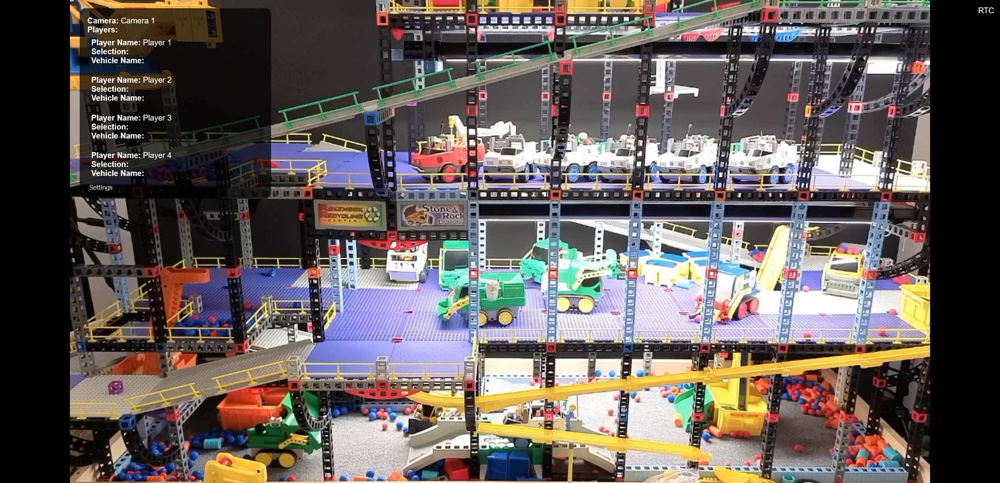

.. MultiRok documentation master file, created by
   sphinx-quickstart on Mon Aug 10 19:06:36 2026.
   You can adapt this file completely to your liking, but it should at least
   contain the root `toctree` directive.

|logo-light| |logo-dark|

A Python webserver for controlling multiple R/C vehicles with optional live video

Download the latest version `here! <https://github.com/csev1755/MultiRok/releases/latest>`_

Requirements
------------

- A computer running Windows 10/11 or macOS 15+
- Ports 1984, 5001, and 8555 forwarded on your router for online play

.. toctree::
   :caption: Contents
   :maxdepth: 2

   getting_started
   devices
